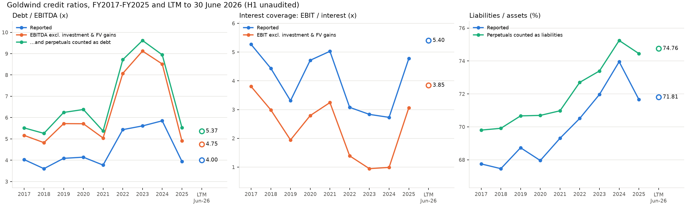

# Green Bond Compliance & Issuer Financial Health Screener
### Case: Goldwind 金风科技 (002202.SZ / 02208.HK)

Screens a Chinese green bond on two questions:
1. **Is the bond actually green?** Scored against the four ICMA Green Bond Principles (GBP) core components with a 14-criterion, 0-2 checklist (module 2). Use-of-proceeds text is also mapped to the 《绿色金融支持项目目录（2025年版）》 (module 3).
2. **Can the issuer service the debt?** Interest coverage and leverage computed from audited annual financial statements, plus the unaudited H1 2026 report for the LTM view.

Bond under review: **金风科技股份有限公司2026年度第二期绿色科技创新债券** (Goldwind 2026 Series 2 Green Technology Innovation Bond; short name 26金风科技MTN002(科创债), code 102683199). RMB 1 billion, 3+N perpetual medium-term note, issued 19 Aug 2026, coupon 2.00%, intended to be accounted for as equity (prospectus pp. 6, 24). Pre-issuance green assessment by 联合赤道 (Lianhe Equator): grade G1.

> Student research project. Not investment advice. Not affiliated with Goldwind.

---

## Status

| Module | Description | Status |
|---|---|---|
| 1. Data collection | Annual financials from public sources, validated across providers | Done |
| 2. GBP compliance scorer | 0-2 checklist across the four GBP pillars | Done |
| 3. LLM project classifier | Maps use-of-proceeds text to the 《绿色金融支持项目目录（2025年版）》 (L1/L2) | Done (n=10 case study, descriptive) |
| 4. Issuer credit health | Interest coverage, Debt/EBITDA, leverage trend, adjusted view | Done (annual and LTM) |

---

## Data and validation

| Source | Used for |
|---|---|
| Sina Finance via `akshare` | Primary: income statement and balance sheet (CAS, A-share) |
| Eastmoney via `akshare` | Depreciation and amortisation (cash-flow statement) |
| `yfinance` (2208.HK) and Eastmoney HK | Cross-check only (IFRS, 2022-2025) |

- Key lines (revenue, pre-tax profit, interest expense, borrowings, D&A) were reconciled across providers for 2022-2025. See `notebooks/01_data_check.ipynb`.
- A-share (CAS) and H-share (IFRS) figures differ slightly (FY2025 revenue: 730.23 vs 727.82 亿元). CAS is used because the bond prospectus follows CAS.
- Total debt vs the prospectus's 有息债务 (RMB 326.90 / 347.93 / 324.32 亿 for 2025 / 2024 / 2023): bank borrowings match exactly. Our total is higher by 37.51 / 47.46 / 53.71 亿 because it also includes 租赁负债 (33.38 / 42.16 / 49.67 亿) and other non-current liabilities due within one year (4.13 / 5.29 / 4.04 亿). Bonds payable are zero in all three years.
- Units: 亿元 (100 million RMB). Annual rows are 31 December year-end, cumulative.
- 2016 has no 利息费用 in the source, so ratios cover **2017-2025**.

---

## Definitions

| Metric | Definition |
|---|---|
| EBIT | 利润总额 + 利息费用 |
| D&A | 固定资产折旧 + 无形资产摊销 + 长期待摊费用摊销 + 使用权资产折旧 |
| EBITDA | EBIT + D&A |
| Total debt (base) | 短期借款 + 一年内到期的非流动负债 + 长期借款 + 应付债券 + 租赁负债 |
| Total debt (broad) | Base + 长期应付款 |
| Interest coverage | EBIT / 利息费用 |
| Debt / EBITDA | Total debt / EBITDA (shown for base and broad) |
| Adjusted EBIT | EBIT − 投资收益 − 公允价值变动收益 |
| Adjusted EBITDA | Adjusted EBIT + D&A |
| Perpetuals | 其他权益工具 (renewable trust loans + perpetual MTNs, booked as equity) |

Chinese terms:

| 中文 | Pinyin | English |
|---|---|---|
| 利息费用 | lìxī fèiyòng | interest expense |
| 利润总额 | lìrùn zǒng'é | pre-tax profit |
| 投资收益 | tóuzī shōuyì | investment income |
| 公允价值变动收益 | gōngyǔn jiàzhí biàndòng shōuyì | fair-value gains |
| 应付债券 | yīngfù zhàiquàn | bonds payable |
| 租赁负债 | zūlìn fùzhài | lease liabilities |
| 长期应付款 | chángqī yīfùkuǎn | long-term payables |
| 募集说明书 | mùjí shuōmíngshū | offering prospectus |

---

## Preliminary observations (computed by `src/credit_ratios.py`)

| | 2023 | 2024 | 2025 |
|---|---|---|---|
| EBIT / interest, headline | 2.83x | 2.73x | 4.77x |
| Adj. EBIT / interest (ex-投资收益 and 公允价值变动收益) | 0.95x | 0.99x | 3.06x |
| Total debt / EBITDA, headline | 5.61x | 5.85x | 3.95x |
| Total debt / adj. EBITDA | 9.12x | 8.52x | 4.91x |
| (Total debt + perpetuals) / adj. EBITDA | 9.62x | 8.95x | 5.53x |
| Liabilities / assets, reported | 71.96% | 73.96% | 71.66% |
| Liabilities / assets incl. perpetuals | 73.39% | 75.24% | 74.45% |

- In 2023-2024, 投资收益 (RMB 2.25 bn and 1.96 bn) was about 58-59% of EBIT. Without it, interest coverage was about 1x versus a headline of 2.7-2.8x.
- FY2025 recovered on operating earnings: adjusted EBIT rose from about RMB 1.2 bn to 3.2 bn. Non-operating items did not drive it (投资收益 fell to RMB 0.73 bn while 公允价值变动收益 rose to RMB 1.08 bn).
- RMB 4.64 bn of perpetual instruments (其他权益工具) are booked as equity at FY2025 and are excluded from reported debt. Counting them lifts liabilities/assets from 71.66% to 74.45%.
- Caveats: treating all 投资收益 as non-core is conservative (it includes JV income and possibly wind-farm disposal gains; the breakdown in the annual-report notes was not checked), so the adjusted figures are a lower bound. Distributions on perpetuals are not added to interest, so coverage is still flattered.

### LTM view (twelve months to 30 June 2026)

The annual ratios stop at the FY2025 balance sheet. `src/credit_ratios_ltm.py` rolls them forward with the 2026 half-year report: flow items are FY2025 + H1 2026 - H1 2025, balance-sheet items are taken at 30 June 2026. Definitions are identical to the annual table.

| Ratio | FY2025 | LTM Jun-2026 |
|---|---|---|
| Interest coverage, EBIT/interest | 4.77x | 5.40x |
| EBITDA/interest | 8.74x | 9.88x |
| Total debt/EBITDA | 3.95x | 4.00x |
| Total debt incl. long-term payables/EBITDA | 4.29x | 4.41x |
| Net debt/EBITDA | 2.83x | 2.85x |
| Liabilities/assets | 71.66% | 71.81% |
| Adj. EBIT/interest | 3.06x | 3.85x |
| Total debt/adj. EBITDA | 4.91x | 4.75x |
| (Debt + perpetuals)/adj. EBITDA | 5.53x | 5.37x |

- Leverage is flat. Total debt rose 7.4% (RMB 36.4bn to 39.1bn) while EBITDA rose 5.8% (RMB 9.2bn to 9.8bn), so debt/EBITDA moved from 3.95x to 4.00x.
- Adjusted coverage improves from 3.06x to 3.85x. EBIT rose, and non-operating gains in the base period (mainly the fair-value gain in H1 2025) dropped out.
- The H1 2026 figures are unaudited.
- The 26金风科技MTN002 bond (RMB 1.0bn, 3+N years, issued 19 August 2026) is not in the 30 June balance sheet. The prospectus says the issuer intends to book it as equity (pp. 6 and 24), estimates that this lowers liabilities/assets by about 1.02% from the FY2025 level, and lists reclassification to debt as a risk (p. 19). No pro-forma is computed here; under the perpetuals-as-debt view it would add RMB 1.0bn to the perpetuals.
- The EBITDA/interest ratios reported by the company (8.44x for H1 2026, 7.13x for FY2025) are lower than the ones above. The company's denominator appears to be larger than P&L interest expense (about RMB 595m against RMB 464m in H1 2026, possibly including capitalised interest; this is inferred from its reported ratios, not stated in the report). This module uses P&L interest expense throughout, so its coverage ratios are higher than the reported ones.

---

## Known limitations

- The LTM view uses the unaudited H1 2026 report and excludes the 26金风科技MTN002 bond, which was issued after 30 June 2026.
- Goldwind's perpetual notes are booked in equity (其他权益工具: RMB 46.43 亿 at FY2025, incl. RMB 21.43 亿 renewable trust loans), so they are not in 应付债券 or in total debt. The adjusted views (Debt + perpetuals)/adj. EBITDA and (Liabilities + perpetuals)/assets add them back.
- 长期应付款 is mainly warranty retention (应付质量保证金) and finance-lease deposits, plus sale-leaseback payables (financing-like). It is excluded from base total debt; the broad version is shown as an upper bound.
- 租赁负债 only exists from the 2019 lease-standard change, which breaks comparability before 2019.
- Missing 应付债券, 租赁负债, 长期待摊费用摊销 and 使用权资产折旧 values are treated as 0.
- Cross-checks cover 2022-2025 only, because yfinance history is limited.

---

## Module 2: GBP compliance scorer

Question: how fully does the case bond's prospectus (募集说明书, mùjí shuōmíngshū) cover the four core components of the ICMA Green Bond Principles?

### Design

- **Rubric.** 14 criteria in four pillars: Use of Proceeds (5), Process for Project Evaluation and Selection (3), Management of Proceeds (3), Reporting (3). Each criterion is scored 0, 1 or 2, and the rubric in `src/gbp_scorer.py` states exactly what earns each score. Equal weights, maximum 28 points.
- **Evidence.** `data/prospectus/gbp_evidence.csv` has one row per bond and criterion: score, confidence (high, medium or low), source pages, the quoted Chinese source text and a rationale. The scores are manual judgments.
- **Script.** `src/gbp_scorer.py` does not judge. It checks that every bond has all 14 criteria exactly once, that scores are 0, 1 or 2, that every row has a source page and a rationale, and that quoted text is present whenever the score is above 0. It then sums scores per pillar.
- **Outputs.** `data/processed/gbp_scores_detail.csv` and `data/processed/gbp_scores_summary.csv`. No network access is needed.

### Results

Case bond only (26金风科技MTN002). Evidence comes from the prospectus and the 联合赤道 pre-issuance assessment report. Every score is a manual judgment with a quoted source passage in `data/prospectus/gbp_evidence.csv`.

| Pillar | Score | Maximum | Share |
|---|---|---|---|
| Use of Proceeds (UoP) | 5 | 10 | 50% |
| Process for Project Evaluation and Selection (PES) | 4 | 6 | 67% |
| Management of Proceeds (MoP) | 4 | 6 | 67% |
| Reporting (REP) | 5 | 6 | 83% |
| **Total** | **18** | **28** | **64%** |

| Criterion | Score | Confidence |
|---|---|---|
| U1 Taxonomy category | 1 | high |
| U2 Project specificity | 1 | high |
| U3 Environmental benefit quantified | 2 | high |
| U4 Directness of link to green asset | 1 | high |
| U5 Refinancing and look-back | 0 | high |
| P1 Process and responsible body | 1 | high |
| P2 Environmental and social risk | 1 | medium |
| P3 Screening checked externally | 2 | high |
| M1 Segregated account | 2 | high |
| M2 Tracking and verification | 2 | high |
| M3 Unallocated proceeds | 0 | medium |
| R1 Allocation reporting | 2 | high |
| R2 Impact reporting | 2 | high |
| R3 External review | 1 | medium |

- Use of Proceeds is the weakest pillar (50%). By the rubric wording, the 0 on U5 means refinancing is not disclosed or is allowed without limit, and the 1s on U1, U2 and U4 mean an ambiguous or inconsistent category, no project list with amounts per project, and an indirect link to the green asset.
- The scores measure how completely the documents address each GBP component. They do not measure environmental impact. With one bond there is no benchmark and no comparison across issuers.
- P2 and R3 are medium confidence: their quotes were matched against the source pages, but the scores depend on judgment (P2: whether issuer-level mitigation counts as specific; R3: no post-issuance verification commitment was found).

### Limitations

- Single rater. There is no second rater and no inter-rater agreement check.
- The rubric is self-designed from the four GBP core components. It is not an ICMA or market-standard scoring method, and the 0-2 scale, the definition of a score of 1 and the equal weights are the author's assumptions.
- The script validates structure, not truth. It does not check the quoted text against the PDF.
- Reporting criteria (R1-R3) score the commitments written in the prospectus, not reports actually delivered after issuance.
- Criteria with medium or low confidence are listed by the script and should be re-checked against the source documents.
- The source documents (the MTN002 prospectus and the 联合赤道 SPO) are not stored in this repository. Page numbers in `gbp_evidence.csv` are the PDF page numbers of the prospectus and the printed page numbers of the SPO (two lower than the SPO PDF page numbers).

---

## Module 3: LLM classification of use-of-proceeds text

Question: can an LLM map the use-of-proceeds text of a green bond to the L1/L2 categories of 《绿色金融支持项目目录（2025年版）》 (lǜsè jīnróng zhīchí xiàngmù mùlù, Green Finance Supported Projects Catalogue, 2025 edition; 9 L1 and 38 L2 categories, L3 not used)?

This is an **n = 10 case study, descriptive only**. It is not an accuracy claim.

### Design

- **Corpus.** Use-of-proceeds text from the prospectuses of 10 green bonds, extracted with `src/extract_use_of_proceeds.py` into `data/labels/corpus_extracted.csv`. Sentences that state the bond's own category are masked in the model input.
- **Hand labels.** `data/labels/gold_labels.csv`: L1, L2 (multi-label allowed), confidence, one alternative L2, non-green share. Waste-to-energy projects are labelled 3.2 and 6.4 together.
- **Classifier.** DeepSeek (`deepseek-flash`) through its OpenAI-compatible API, thinking disabled so `temperature=0` applies, JSON output, prompt version `v1`. The prompt sees only the use-of-proceeds text: no bond ID, no declared category, no hand label. Look-through (chuāntòu, 穿透) rule: for refinancing bonds, classify the underlying projects. Working capital gets no category.
- **Reproducibility.** Every response is cached in `outputs/llm_cache/` with model, prompt version, token usage and timestamp.

### Results

| Metric (L2) | Value |
|---|---|
| Exact set match | 4/10 (95% Wilson CI 17-69%) |
| At least one ID in common | 7/10 (CI 40-89%) |
| Overlap, hand-label alt counted as acceptable | 8/10 (CI 49-94%) |
| Micro precision / recall / F1 | 64% (7/11) / 44% (7/16) / 0.52 |
| Agreement with the bond's declared category (only 4 bonds have one) | LLM 3/4, hand labels 4/4 |

Errors by type: exact 4, disjoint 2, subset missing hand label 2, overlap mixed 1, disjoint but hits hand-label alt 1.

### Error analysis

Verdicts are written by hand in `outputs/error_view.txt`, one per non-exact bond.

| Bond | Hand L2 | LLM L2 (alt) | Verdict |
|---|---|---|---|
| fsh_water_2026 | 6.4 | 2.3 (6.4) | MODEL_ERROR |
| cecep_2026 | 3.2;4.2;6.4 | 2.5;4.2 (3.2;6.4) | AMBIGUOUS |
| cepg_env_2025 | 3.2;6.4 | 6.4 (4.2) | AMBIGUOUS |
| changzhou_binjiang_2020 | 1.3;6.5 | 4.2 (6.5) | MODEL_ERROR |
| henan_water_2021 | 2.3;5.2 | 2.3 (5.2) | PROTOCOL |
| yunnan_water_2023 | 2.3;5.2 | 6.4 (5.2) | AMBIGUOUS |

- Errors cluster at category boundaries: water treatment (2.3 / 5.2 / 6.4), waste-to-energy (3.2 / 4.2 / 6.4), heating (4.2 / 6.5 / 1.3) and bonds with several project types.
- In the catalogue, power from household waste (code 4417) appears under both 3.2.6 and 4.2.3, so two of the six cases are partly a catalogue overlap.
- The model returns one primary L2 per project, while the hand labels allow two. Recall is therefore capped by the protocol, not only by the model.
- The model's quoted evidence is often only the project name. In changzhou it returns high confidence for 4.2 although the text names no heat source.

### Limitations

- Single labeler. The labels were discussed with one non-expert second person. fsh was first proposed with Claude's help.
- henan was revised after seeing the model output (non-green share 30% to 0%, flagged in `label_note`).
- Protocol mismatch: prompt `v1` allows one L2 plus one alt per project, the hand labels allow two L2 per project. The prompt also does not contain the waste-to-energy rule used in the labels.
- n = 10, so the confidence intervals are wide. 4.2 is over-represented in the sample.
- Only 4 of 10 bonds have a valid declared category, so agreement with it is a weak check.
- The texts of changzhou (2019 edition) and of henan and yunnan (2019 and 2021 editions) cite older catalogue editions than the 2025 one used here.
- The error verdicts were written by the same person who made the labels, after seeing the model output.
- One model (DeepSeek) and one prompt version. Prompt `v2` (two L2 per project) is not run.

---

## Repository structure

```
data/
  raw/          provider downloads (gitignored, regenerate with the script)
  processed/    cleaned inputs and ratios (committed)
  prospectus/   bond prospectuses used for modules 2 and 3
  labels/       catalogue_categories.csv, gold_labels.csv, corpus_extracted.csv
notebooks/      01_data_check.ipynb: cross-provider validation
src/
  data_collection.py          module 1
  gbp_scorer.py               module 2
  extract_use_of_proceeds.py  module 3: text extraction
  llm_classifier.py           module 3: DeepSeek classification, cached
  evaluate_classifier.py      module 3: metrics against hand labels
  show_errors.py              module 3: builds error_view.txt for manual verdicts
  credit_ratios.py            module 4
  credit_ratios_ltm.py        module 4: LTM ratios
docs/           research note (planned)
outputs/        llm_cache/, llm_predictions.csv, eval_*.csv/txt, error_view.txt
```

## Reproduce

```bash
python -m venv .venv
.venv\Scripts\activate          # Windows
pip install -r requirements.txt

python src/data_collection.py   # writes data/raw and data/processed/goldwind_credit_inputs_annual.csv
python src/credit_ratios.py     # writes data/processed/goldwind_credit_ratios_annual.csv
python src/credit_ratios_ltm.py # writes data/processed/goldwind_credit_ratios_ltm.csv
python src/extract_use_of_proceeds.py   # writes data/labels/corpus_extracted.csv
python src/llm_classifier.py            # needs .env (see .env.example); writes outputs/llm_predictions.csv
python src/evaluate_classifier.py       # writes outputs/eval_per_bond.csv and eval_summary.txt
```

Turn **VPN off** before running `data_collection.py`; Sina Finance requests fail with SSL errors otherwise.

## Analysis and research note

- **Notebook:** [`notebooks/02_analysis.ipynb`](notebooks/02_analysis.ipynb) re-runs every figure from the CSVs in `data/` and `outputs/`: credit ratios, the 2025 deleveraging decomposition, the MTN002 pro-forma, GBP scores and the classifier evaluation.
- **One-page note:** [`docs/goldwind_mtn002_note.md`](docs/goldwind_mtn002_note.md) summarises the findings.

Headline findings: debt/EBITDA is flat at 4.00x LTM against 3.95x in FY2025; the 2025 improvement came from EBITDA, not debt paydown; MTN002 moves debt/EBITDA by at most 0.11x under any accounting treatment; the bond scores 18/28 on GBP documentation, weakest on use of proceeds.



## Roadmap

- [x] Adjusted EBIT/EBITDA and perpetuals-as-debt view
- [x] LTM ratios (FY2025 + H1 2026 − H1 2025)
- [x] Extract use of proceeds from the 募集说明书
- [x] GBP scorer (rubric 0-2 per pillar)
- [x] LLM classifier with hand labels, `temperature=0`, cached responses, logged model and prompt version
- [x] Analysis notebook
- [x] One-page research note